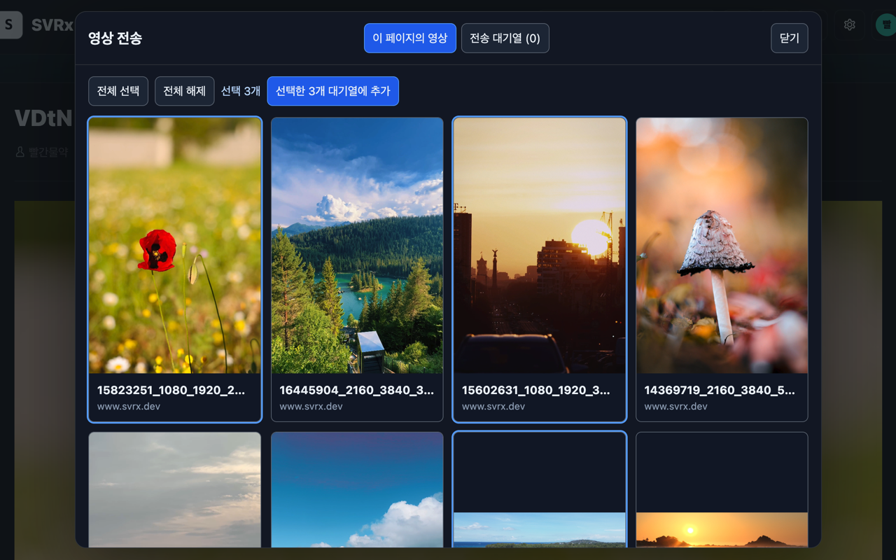

# Video Download to NAS Extension

Video Download to nas 의 크롬 엣지 확장 프로그램입니다.

1.2.4 업데이트 내용:
X.com(트위터) 타임라인 등 스트리밍 피드 환경에서 개별 영상 게시물 인식 및 다운로드 지원 개선

피드 페이지 URL이 영상 주소로 잘못 전송되는 현상 방지

1.2.3 업데이트 내용:
영상 다운로드 요청 시 URL 또는 비디오 ID가 파일명으로 잘못 전달되어 서버 저장 파일명이 왜곡되는 문제 수정

실제 첨부 파일명이 있는 경우에만 파일명을 서버에 전달하도록 개선

1.2.2 업데이트 내용:
현재 페이지의 여러 영상을 카드 목록에서 한 번에 선택해 전송 대기열에 추가하는 일괄 전송 기능 추가

전송 대기열에서 서버 접수 상태 확인, 일시정지·재개, 실패 항목 재시도, 대기 항목 및 접수 완료 항목 정리 기능 추가

영상 썸네일과 원본 파일명 표시를 개선하고 영상 선택 및 전송 대기열 UI/UX 개편

1.2.1 업데이트 내용:
브라우저 로컬 미디어 URL 처리 개선

1.2.0 업데이트 내용:
VDtN 서버 토큰 인증 기능 추가

1.1.15 업데이트 내용:
자막 언어 선택 기능 추가

1.1.14 업데이트 내용:
자막(srt, vtt) 다운로드 기능 추가

1.1.13 업데이트 내용:
몇몇 코드 수정

1.1.12 업데이트 내용:
오버레이 창에 많은 목록이 표시될 때 스크롤 가능 하도록 수정

1.1.11 업데이트 내용:
오버레이 상의 blob영상 다운로드 방식 수정

1.1.1 업데이트 내용:
옵션 입력 편의성 수정

1.1.0 업데이트 내용 :
옵션UI 수정 및 브라우저 확장 프로그램 아이콘 클릭시 다운로드 가능 목록 표시 기능 추가

1.0.11 업데이트 내용 : 
이름과 아이콘 변경

1.0.1 업데이트 내용 : 
유튜브 동영상이 아닌 웹 브라우저 동영상에도 사용 가능

시놀로지 나스 도커에서 실행 가능한 Video Download to nas 서버 의 확장 프로그램 입니다.

영상 링크 우 클릭 또는 영상 텍스트 드래그 후 우 클릭시 
컨텍스트 메뉴가 표시됩니다.

해상도를 선택하면 Video Download to nas 설치 시 지정한 폴더로 mp4 파일이 저장 됩니다.

그리고 영상을 우클릭 후 컨텍스트 메뉴에서 옵션을 선택한 후 저장하는 기존 방식 외에 

브라우저의 확장 프로그램 아이콘을 클릭 했을 때 현재 페이지에서 나스로 다운로드 가능한 영상이 있을 경우

카드 목록이 표시되고 여러 영상을 선택해 전송 대기열에 추가할 수 있습니다.

전송 대기열은 다른 페이지로 이동하거나 선택 화면을 닫아도 백그라운드에서 순서대로 서버에 요청합니다.
브라우저를 완전히 종료했다가 다시 실행한 경우에는 대기열 화면에서 재개해야 합니다.

확장 프로그램의 `접수 완료` 표시는 VDtN 서버가 요청을 받은 상태를 뜻합니다. 실제 파일 다운로드 진행과 완료 여부는 VDtN 서버 화면에서 확인해야 합니다.

이 확장 프로그램을 사용하기 위해서는 Video Download to nas 서버 서비스를 나스에 설치 해야 합니다

가이드 : https://svrforum.com/nas/2866255

설정에는 Video Download to nas 에서 설정한 config url 또는 아이디, 토큰, 패스워드와 

Video Download to nas의 웹페이지 주소를 rest api 부분에 입력해 준 후 저장 버튼을 눌러 저장합니다.

영상 링크 화면에서 우클릭 후 컨텍스트 메뉴에서 해상도를 선택하거나 카드 목록에서 영상을 선택해 전송 대기열에 추가합니다.

그 후 나스의 폴더에 정상적으로 다운로드가 됐는지 확인 해보시고 

안된다면 아이디와 패스워드 혹은 접속 주소가 정상인지 확인 해보시기 바랍니다.
